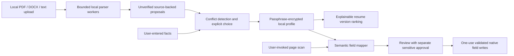

# Design and trust boundaries

`core.js` is a browser/Node shared deterministic domain module. `parseResume` extracts proposals rather than a verified profile. A candidate's source is the exact input text hash, file name, line and excerpt. Importing identical extracted content is idempotent. Different candidate values clear a previous selection. `verifyCandidate` records a user choice; `setUserFact` records an explicit manual answer. Sensitive keys cannot be created through parsing or verified from resume provenance. Deletion removes candidates rather than merely hiding them.

The ranker weighs job tokens by rarity across imported resume versions and lists matching tokens. It suggests only a unique positive winner and never fabricates missing skills. A manual confirmation records the selected resume; attaching its original PDF is manual. This is an explainable lexical ranker, not a model trained on hiring outcomes.

`vault.js` encrypts the entire serialized profile with AES-256-GCM and authenticated format context. Each save generates fresh salt and IV. The key derives from a minimum 12-character passphrase using 210,000 PBKDF2-SHA256 iterations. Wrong passphrases and ciphertext changes fail authentication. Storage is restricted to trusted extension contexts using the Chrome storage API. This is at-rest protection, not hardware-backed storage, XSS immunity, or a guarantee against an unlocked-device attacker. [Web Crypto derivation API](https://developer.mozilla.org/en-US/docs/Web/API/SubtleCrypto/deriveKey).

`page.js` functions are self-contained because Chrome injects function source into an isolated world. Scanning retains direct element handles and a random nonce in that world. Metadata includes associated/ARIA labels, autocomplete, form action, option values and editability. The mapper refuses contradictory hints and uses only unique exact option matches. Rule confidence is a heuristic label and is not a calibrated probability.

The scanner reports only whether supported fields already contain a value, without copying that value into a review snapshot. It does not read blocked password/hidden/file values. The mapper uses the presence marker to preserve existing answers.

The popup constructs proposed values from verified facts and displays their sources, page URL and actual per-field form destinations. It sends only selected values and destination/field validation metadata to the page. Sensitive values are unchecked by default; the extra approval applies only to the exact current review. `applyPage` consumes the nonce before validating, preflights all selected fields and rechecks destinations and live radio group membership before each write. An input/change handler that changes later fields or destinations stops the fill and reports the completed subset. Native setters and input/change events support ordinary reactive forms. There is no submission, click automation, answer generation, file upload, external fetch or periodic scan.

Lock and deletion synchronously fence the session generation, disable mutation controls and clear plaintext before awaiting queued writes. The write queue is then stable: existing snapshots finish before deletion removes the vault, while delayed imports, scans and old callbacks cannot enqueue new snapshots or restore old UI. Unlock remains disabled during the transition. Failed deletion reports a locked state and requires retry; it never claims success when removal failed.

The page is untrusted input, not an instruction source. Prompt-like labels are strings and unknown labels abstain. DOM rendering uses `textContent`, never resume-derived HTML. Hostile ATS JavaScript can still observe any value placed in its own field; the user's destination approval is the boundary for that disclosure. The prototype does not claim to stop a page intentionally relabeling a normal field to disguise its purpose.

`background.js` responds only to a user toolbar action, remembers tab/window IDs in session storage and opens/reuses a persistent companion window. The window uses Web Locks to block competing unlocked workspaces. The activeTab grant expires on cross-origin navigation; the user invokes the toolbar on the new destination. No host permission or always-on scanner is requested.

`upload.js` validates format/size, hashes original bytes and stages every file before importing any. PDF.js runs with an explicitly supplied nested local worker; no eval, remote font/cMap URLs or document JavaScript is used. It records extracted page-to-line provenance. Mammoth is used only for raw text, never HTML. Before Mammoth, `zip_guard.js` validates names/headers/entry counts/declared sizes and streams inflation with actual size and CRC checks. Workers are terminated on cancellation or a 15-second timeout. These bounds reduce resource exposure; they are not OS-level sandbox/heap guarantees or comprehensive hostile-document qualification.

All mutations are serialized as private profile drafts. The 4 MiB serialized UTF-8 admission limit leaves headroom under extension storage quota after base64 encryption. Only a successfully persisted draft is published into the live profile. A failed save/import leaves both live and durable facts unchanged. Generation fencing still clears plaintext synchronously on lock/deletion and prevents delayed work from recreating a deleted vault.

Native date/month conversion validates exact calendar values and bounds; it never infers a day. Label extraction removes embedded select/textarea content from wrapped labels. Effective option disabled state includes optgroups. Scan/apply both recheck visibility inherited from ancestors and native fieldset disabled state.

The localhost demo uses an explicitly separate bridge and synthetic iframe to emulate Chrome APIs. A separate suite loads the exact packaged MV3 extension in a new isolated Chromium profile, invokes its actual toolbar action and verifies real storage/workers/scripting/grants against localhost only. It does not prove real employer ATS compatibility, personal Chrome/Edge installation or Web Store qualification.

Tradeoffs: conservative mapping sacrifices coverage to preserve abstention; explicit per-fact verification adds first-use work; window memory requires unlocking again after close; local PDF/DOCX libraries increase package size and document parsing remains limited by text order. OCR, iframe/shadow-DOM traversal, custom widget/site adapters, attachment automation and a consented human timing study remain roadmap items.
